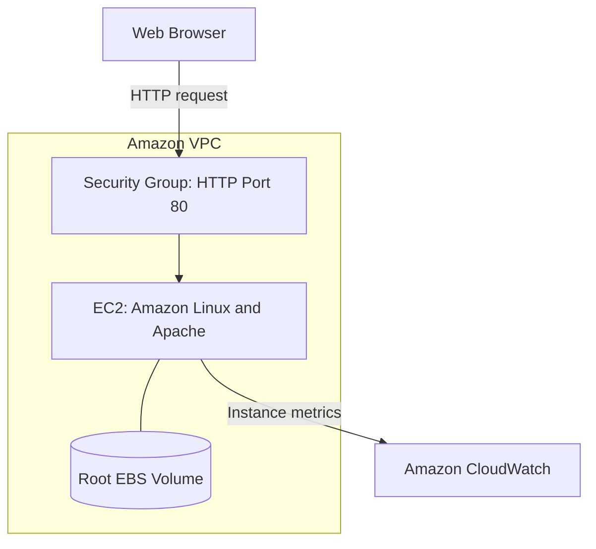

<div align="center">

# ☁️ Amazon EC2 Web Server Deployment

### Deploying, Securing, and Managing a Linux Web Server on AWS


<br />


**A cloud infrastructure project covering automated deployment, network access, monitoring, and resource scaling.**

[Overview](#-project-overview) •
[Architecture](#-architecture) •
[Implementation](#-implementation) •
[Lessons Learned](#-what-i-learned) •
[Screenshots](#-project-screenshots)

</div>

---

## 📌 Project Overview

This project demonstrates how to deploy and manage an Apache web server on Amazon EC2 using Amazon Linux 2023.

The implementation covers automated server configuration with Bash user data, HTTP access through an EC2 security group, instance monitoring, and vertical scaling of compute and storage.

Through this project, I developed a better understanding of how application configuration, networking, and infrastructure management work together in AWS.

## 🎯 Project Goals

- Deploy a Linux-based web server on Amazon EC2.
- Automate Apache installation and startup.
- Configure inbound access for HTTP traffic.
- Inspect instance health and performance metrics.
- Increase compute and storage capacity.
- Use termination protection to help prevent accidental deletion.
- Clean up resources after testing.

## 🏗️ Architecture

The browser connects to the instance’s public IPv4 address over HTTP. The security group controls inbound access, Apache serves the page, and the root EBS volume stores the operating system and website files.



## 🧰 Technology Stack

| Technology | Role |
| --- | --- |
| **Amazon EC2** | Hosts the virtual server |
| **Amazon Linux 2023** | Provides the server operating system |
| **Apache HTTP Server** | Serves the web page |
| **Bash** | Automates initial server configuration |
| **Amazon VPC** | Provides the network environment |
| **Security Groups** | Control instance traffic |
| **Amazon EBS** | Provides persistent block storage |
| **Amazon CloudWatch** | Displays instance metrics |

---

## ⚙️ Implementation

### 1. Configure the EC2 Instance

The server configuration uses:

| Setting | Value |
| --- | --- |
| Instance name | `Web Server` |
| Operating system | Amazon Linux 2023 |
| Initial instance type | `t3.micro` |
| Root EBS volume | 8 GiB |
| Termination protection | Enabled |
| Initial inbound rules | None |

The instance requires an internet-accessible subnet and a public IPv4 address for direct browser access.

Interactive SSH access is not required for this implementation because the initial configuration runs through user data.

### 2. Automate Web Server Setup

The following user-data script installs Apache, enables automatic startup, and creates a sample web page:

```bash
#!/bin/bash
set -e

# Install Apache HTTP Server
yum -y install httpd

# Start Apache automatically when the instance boots
systemctl enable httpd

# Start the service immediately
systemctl start httpd

# Create the default web page
echo '<html><h1>Hello From Your Web Server!</h1></html>' \
  > /var/www/html/index.html
```

<details>
<summary><b>📝 Script breakdown</b></summary>

<br />

| Command | Purpose |
| --- | --- |
| `set -e` | Stops execution if a command fails |
| `yum -y install httpd` | Installs Apache without an interactive confirmation |
| `systemctl enable httpd` | Enables the service at boot |
| `systemctl start httpd` | Starts the service immediately |
| `echo ... > index.html` | Creates the page Apache serves |

User-data shell scripts normally run during the first boot. Package installation may continue after the instance enters the **Running** state.

</details>

> 💡 **Technical decision:** User data makes initial server configuration repeatable and reduces manual setup.

### 3. Configure HTTP Access

The security group initially contains no inbound rules. This provides a useful way to observe how network access affects application availability.

To allow access to the sample page, add the following inbound rule:

| Setting | Value |
| --- | --- |
| Type | HTTP |
| Protocol | TCP |
| Port | `80` |
| Source | `0.0.0.0/0` — Anywhere-IPv4 |

Access the server using:

```text
http://<PUBLIC_IPV4_ADDRESS>
```

**Expected page content:**

> # Hello From Your Web Server!

This rule permits public IPv4 access to the HTTP page. The configuration does not include HTTPS.

> 🛡️ **Key insight:** A running instance and an installed web server still require the correct network rules before browser access works.

### 4. Inspect Health and Performance

The EC2 console provides two complementary views:

| Monitoring Feature | Purpose |
| --- | --- |
| **System status checks** | Detect problems with the underlying AWS infrastructure |
| **Instance status checks** | Detect operating system and network configuration problems |
| **Attached EBS checks, when displayed** | Check whether attached volumes can complete I/O |
| **CloudWatch metrics** | Show resource usage and performance over time |
| **Instance screenshot** | Provides visibility into the instance console |

Useful metrics include CPU utilization, network traffic, and status check failures.

> 📊 **Key insight:** Health checks help identify failures, while performance metrics help explain workload behavior.

### 5. Scale Compute and Storage

The project explores vertical scaling by changing the instance type and increasing EBS capacity.

| Resource | Initial Configuration | Updated Configuration |
| --- | --- | --- |
| Instance type | `t3.micro` | `t3.small` |
| vCPUs | 2 | 2 |
| Memory | 1 GiB | 2 GiB |
| Root EBS capacity | 8 GiB | 10 GiB |

The procedure is to:

1. Stop the instance.
2. Change its instance type to `t3.small`.
3. Identify the attached root EBS volume.
4. Increase its capacity to 10 GiB.
5. Start the instance.
6. Verify its configuration and test HTTP access again.

<details>
<summary><b>🔎 Scaling considerations</b></summary>

<br />

- Compute and storage capacity are managed separately.
- The instance must be stopped before changing its type in this procedure.
- An automatically assigned public IPv4 address can change after stopping and starting.
- EBS storage remains allocated while the instance is stopped.
- Increasing EBS capacity may require extending the partition and filesystem.
- Apache starts automatically after reboot because its service is enabled.

</details>

> 📈 **Key insight:** Scaling should target the resource a workload needs. This change increases memory while keeping the same vCPU count.

### 6. Manage Resource Deletion

Termination protection helps prevent accidental instance deletion.

To intentionally remove a protected instance:

1. Open **Actions → Instance settings → Change termination protection**.
2. Disable protection and save.
3. Choose **Instance state → Terminate (delete) instance**.
4. Confirm the action.
5. Check for remaining resources.

| Action | Effect |
| --- | --- |
| **Stop** | Shuts down the instance so it can be started again |
| **Terminate** | Permanently deletes the instance |

The root EBS volume’s deletion behavior depends on its **Delete on termination** setting.

> 🧹 **Key insight:** Resource cleanup is part of infrastructure management. Stopping an instance does not remove its attached EBS storage.

---

## 🔍 Troubleshooting Approach

| Symptom | What to Check |
| --- | --- |
| Website does not load | HTTP rule, attached security group, public IPv4 address, and `http://` URL |
| Instance is running but the page is unavailable | Allow time for user-data setup; inspect Apache if an authorized access method is available |
| HTTP requests time out | Subnet route, internet gateway, and network ACLs |
| Website stops responding after a stop/start cycle | Current public IPv4 address and instance health |
| EBS capacity increased but usable space did not | Partition and filesystem sizes |
| Termination is blocked | Termination protection setting |

## 🧠 What I Learned

### Automation Improves Repeatability

Using user data helped me understand how a server can configure itself during its initial boot.

### Networking Affects Application Availability

I learned to check both the application and its network access rules when troubleshooting an unreachable website.

### Compute and Storage Scale Independently

Changing the instance type adjusts compute resources, while modifying an EBS volume changes storage capacity.

### Monitoring Provides Context

Status checks indicate health problems, while CloudWatch metrics help explain performance and resource usage.

### Resource Management Includes Cleanup

Stopping, restarting, and terminating have different effects. Understanding those differences helps avoid unwanted downtime, data loss, and unnecessary resource allocation.

## 📸 Project Screenshots

<!--
### EC2 Instance Configuration


### Apache Web Page


### HTTP Access Rule


### Updated Compute Capacity


### Updated Storage Capacity

-->

*Project screenshots will be added here.*

## 🔭 Future Improvements

- Configure HTTPS with a domain name and certificate.
- Deploy a custom website.
- Configure secure administrative access.
- Create CloudWatch alarms.
- Automate infrastructure provisioning.
- Explore load balancing and automatic scaling.

## 💭 Reflection

This project strengthened my understanding of the components behind a cloud-hosted web server.

The most useful lesson was learning to connect infrastructure settings with application behavior. A website depends on more than an active EC2 instance: its software, network rules, storage, and startup configuration all affect availability.

I also gained a clearer understanding of how to adjust resources and manage the server throughout its lifecycle.

## 📚 References

- [Amazon EC2 Documentation](https://docs.aws.amazon.com/ec2/)
- [EC2 User Data](https://docs.aws.amazon.com/AWSEC2/latest/UserGuide/user-data.html)
- [Security Groups](https://docs.aws.amazon.com/AWSEC2/latest/UserGuide/using-network-security.html)
- [EC2 Status Checks](https://docs.aws.amazon.com/AWSEC2/latest/UserGuide/monitoring-system-instance-status-check.html)
- [Changing an Instance Type](https://docs.aws.amazon.com/AWSEC2/latest/UserGuide/ec2-instance-resize.html)
- [Extending an EBS Filesystem](https://docs.aws.amazon.com/ebs/latest/userguide/recognize-expanded-volume-linux.html)

---

<div align="center">

**☁️ Building cloud skills through practical projects.**

<sub>Animated header by <a href="https://github.com/DenverCoder1/readme-typing-svg">Readme Typing SVG</a> · Badges by <a href="https://shields.io">Shields.io</a></sub>

</div>